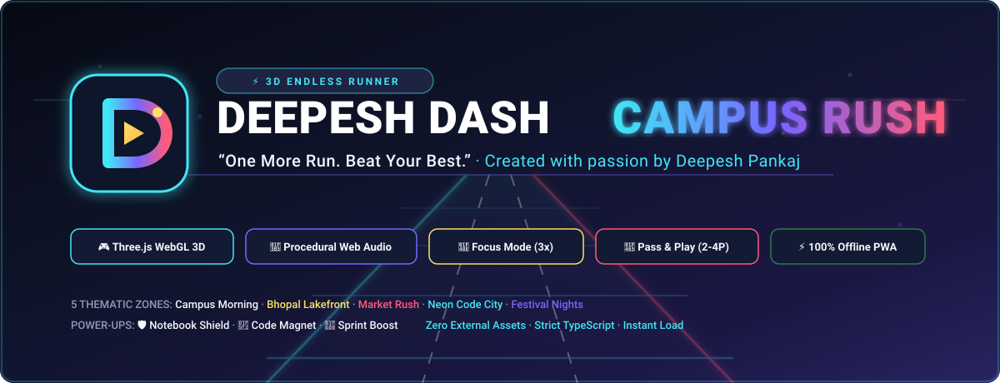

<p align="center">
  
</p>

<p align="center">
  <strong>“One More Run. Beat Your Best.”</strong><br>
  <em>A high-performance, offline-first 3D arcade endless runner built with Three.js, TypeScript, and Vite.</em>
</p>

<p align="center">
  <a href="https://github.com/deepeshpankaj01/CAMPUS-RUSH/actions"></a>
  <a href="https://threejs.org/"></a>
  <a href="https://www.typescriptlang.org/"></a>
  <a href="https://vitejs.dev/"></a>
  <a href="./public/manifest.webmanifest"></a>
  <a href="./LICENSE"></a>
</p>

---

## 📌 Table of Contents

- [Overview & Narrative](#-overview--narrative)
- [Key Features](#-key-features)
- [Signature Gameplay Mechanics](#-signature-gameplay-mechanics)
- [Thematic Procedural Zones](#-thematic-procedural-zones)
- [Obstacle & Collectible Catalog](#-obstacle--collectible-catalog)
- [Character Locker & Outfits](#-character-locker--outfits)
- [Pass & Play Local Multiplayer](#-pass--play-local-multiplayer)
- [Procedural Web Audio Engine](#-procedural-web-audio-engine)
- [Controls Reference](#-controls-reference)
- [System Architecture](#-system-architecture)
- [Getting Started](#-getting-started)
- [Verification & Test Suite](#-verification--test-suite)
- [Deployment Guide](#-deployment-guide)
- [Extending the Game](#-extending-the-game)
- [Author & Credits](#-author--credits)
- [License](#-license)

---

## 📖 Overview & Narrative

**CAMPUS RUSH** is a 3D endless runner set across an Indian urban university campus.

The player steps into the shoes of a student sprinting through the campus to reach the prestigious **Demo Day showcase** before time runs out. Along the path, players dodge campus security barricades, potholes, supply carts, tea stalls (*chai tapris*), and iconic green-and-yellow auto-rickshaws, while sliding beneath low-hanging event banners, snatching Byte Coins, and collecting Idea Sparks to unleash the game's signature **Focus Mode**.

### Design Philosophy
- **Zero Asset Latency**: Built without external 3D models or audio files; all 3D geometries and materials are generated via Three.js primitives, and all music and sound effects are procedurally generated in real time through the Web Audio API.
- **Offline First**: Fully installable as a Progressive Web App (PWA) with a dedicated Service Worker caching strategy.
- **Fair Procedural Generation**: The obstacle generation algorithm guarantees that every row has at least one clear or jumpable/slideable lane, rewarding skill over pure chance.

---

## ⚡ Key Features

- **Smooth 3-Lane Movement**: Spring-damped lateral interpolation with dynamic banking roll when switching lanes.
- **Full Action Palette**: Responsive jump physics and crouching slide with accurate real-time bounding box adjustments.
- **Signature Mechanic — Focus Mode**: Collect 3 Idea Sparks to trigger a 5.5-second electric cyan/violet neon overdrive state with a **3x score multiplier** and tempo acceleration.
- **3 Functional Power-Ups**:
  - 🛡️ **Notebook Shield**: Absorbs a collision hazard with an active forcefield bubble.
  - 🧲 **Code Magnet**: Pulls all coins across all 3 lanes within a 15-meter radius for 10 seconds.
  - 🚀 **Sprint Boost**: 6-second invincibility rush at +60% velocity with a burning flame trail.
- **5 Procedural Environments**: Seamless transitions through Campus Morning, Bhopal Lakefront, Market Rush, Neon Code City, and Festival Nights.
- **Pass & Play Local Multiplayer**: 2 to 4 players can compete in round-based heats on the same physical phone or keyboard without internet or registration.
- **Missions & Achievement System**: 8 missions with live tracking and Byte Coin rewards.
- **Local Leaderboard**: Top 10 runs with player initials, distance, coins, and dates stored in `localStorage`.
- **Procedural Synthesizer**: Multi-track synthwave soundtrack with dynamic tempo scaling linked to player velocity.
- **Comprehensive Mobile & Accessibility Support**: Keyboard controls, fluid touch gestures, and an optional on-screen virtual D-Pad.

---

## 🚀 Signature Gameplay Mechanics

```
               [ 3 IDEA SPARKS COLLECTED ]
                           │
                           ▼
              ┌─────────────────────────┐
              │   FOCUS MODE ACTIVATED  │
              │     (5.5s Overdrive)    │
              └────────────┬────────────┘
                           │
     ┌─────────────────────┼─────────────────────┐
     ▼                     ▼                     ▼
[ 3x Score Multiplier ] [ Synth BPM Boost ] [ Neon Visual Filter ]
```

### 1. Focus Mode
Collecting **3 glowing Idea Sparks (💎)** triggers the signature **Focus Mode**:
- **Duration**: 5.5 seconds.
- **Score Multiplier**: 3x multiplier applied to all score and distance points.
- **Audio Overdrive**: Synthesizer tempo kicks into high-octane BPM with accented arpeggiators.
- **Visual Transformation**: The environment and player light up with electric cyan and vivid violet neon aura shaders.

### 2. Functional Power-Ups

| Power-Up | Icon | Duration | Mechanic |
| :--- | :---: | :---: | :--- |
| **Notebook Shield** | 🛡️ | 1 Impact | Generates an energy sphere bubble that absorbs one fatal collision without ending the run. |
| **Code Magnet** | 🧲 | 10.0s | Attracts all Byte Coins across all three lanes within a 15-meter radius directly to the player. |
| **Sprint Boost** | 🚀 | 6.0s | Propels the player at +60% speed with invulnerability through obstacles and a vibrant fire particle trail. |

---

## 🌆 Thematic Procedural Zones

As the player sprints deeper into the campus, the world transitions across 5 environments:

| Zone | Distance | Atmosphere & Key Visuals |
| :--- | :---: | :--- |
| **Zone A: Campus Morning** | `0 – 450m` | Red academic brick facades, campus gates, lush green trees, and crisp morning sunlight. |
| **Zone B: Bhopal Lakefront** | `450 – 950m` | Scenic lakeside drive, specular water reflections, promenade railings, and golden hour sky. |
| **Zone C: Market Rush** | `950 – 1500m` | Vibrant Indian street market with colorful striped canopies, signboards, and bustling street stalls. |
| **Zone D: Neon Code City** | `1500 – 2100m` | Cyberpunk tech hub with dark geometric skyscrapers, illuminated window matrices, and cyan fog. |
| **Zone E: Festival Nights** | `2100m+` | Campus tech-fest celebration with decorative glowing lanterns (*kandils*) and overhead fairy lights. |

---

## 🚧 Obstacle & Collectible Catalog

### Obstacles

| Obstacle | Evading Action | Description |
| :--- | :---: | :--- |
| **Campus Barricade** | `Jump` or `Switch Lane` | Standard police/security road barricades with reflective hazard tape. |
| **Traffic Cones** | `Jump` or `Switch Lane` | High-visibility orange road construction cones. |
| **Pothole** | `Jump` or `Switch Lane` | Campus road hazard requiring a leap across the damaged asphalt. |
| **Campus Cart** | `Switch Lane Only` | Heavy utility trolley packed with supplies; cannot be jumped over. |
| **Chai Tapri** | `Switch Lane Only` | Roadside campus tea stall with steel counter, kettle, and benches. |
| **Campus Auto-Rickshaw** | `Switch Lane Only` | Iconic Indian three-wheeler vehicle blocking the lane. |
| **Overhead Fest Banner** | `Slide Only` | Low-hanging festival banner; requires sliding underneath to avoid head impact. |

### Collectibles

- **Byte Coins (⚡)**: Primary currency used to purchase outfits in the Locker modal.
- **Idea Sparks (💎)**: Glowing cyan octahedron crystals that charge the Focus Mode meter.

---

## 🥋 Character Locker & Outfits

Players can unlock and equip stylized student outfits using Byte Coins:

| Outfit | Cost | Color Scheme | Lore Description |
| :--- | :---: | :--- | :--- |
| **Demo Day Hustle** | `Default (Free)` | Deep Indigo & Electric Cyan | The runner's signature pitch hoodie with laptop compartment backpack. |
| **Bhopal Lakefront Casual** | `100 Coins` | Warm Saffron & Sunset Coral | Relaxed VIP Road lakefront jacket with matching shades. |
| **Cyber Hacker Neon** | `250 Coins` | Midnight Dark & Emissive Violet | Cyber matrix runner with circuit lines and cyan glow accents. |
| **Campus Fest Fusion** | `500 Coins` | Royal Blue & Festive Marigold | Royal traditional-modern fusion attire for celebrating campus victory. |

---

## 👥 Pass & Play Local Multiplayer

Designed for friendly competitions on a single device without accounts or internet:

1. Click **Pass & Play** on the Main Menu.
2. Select the number of competitors (**2 to 4 Players**) and enter names.
3. Players take turns completing a run.
4. An on-screen prompt announces whose turn is up next.
5. After all players finish, a final podium screen displays rankings, distances, and scores, and crowns the winner with confetti.

---

## 🎵 Procedural Web Audio Engine

`SoundSynthesizer.ts` produces sound via the native **Web Audio API**:

- **No external MP3 or WAV files**: Zero download delay, zero network requests, and zero 404s.
- **Multi-Track Synthwave Soundtrack**:
  - Dual-oscillator sub-bass and mid-bass lines.
  - Plucked melodic arpeggios that adapt tempo dynamically as running speed accelerates.
  - High-tempo lead sequence when **Focus Mode** triggers.
- **Procedural Sound Effects**: Jump whoosh, slide sweep, coin chime, spark resonator, shield hum, crash impact, and UI click effects.
- **Volume & Mute Controls**: Independent adjustments for Music and SFX persisted in local storage.

---

## 🎮 Controls Reference

### Desktop Keyboard

| Key | Action |
| :--- | :--- |
| <kbd>A</kbd> / <kbd>←</kbd> | Move Left (Switch to left lane) |
| <kbd>D</kbd> / <kbd>→</kbd> | Move Right (Switch to right lane) |
| <kbd>W</kbd> / <kbd>↑</kbd> / <kbd>Space</kbd> | Jump over ground obstacles |
| <kbd>S</kbd> / <kbd>↓</kbd> | Slide crouch beneath banners |
| <kbd>P</kbd> / <kbd>Esc</kbd> | Pause / Resume run |

### Mobile Touch Gestures

| Gesture | Action |
| :--- | :--- |
| **Swipe Left** | Switch to left lane |
| **Swipe Right** | Switch to right lane |
| **Swipe Up** | Jump |
| **Swipe Down** | Slide crouch |
| **On-Screen D-Pad** | Optional large touch buttons toggled in the Settings modal |

---

## 🏗️ System Architecture

```
CAMPUS RUSH/
├── public/                     # Static assets & PWA configuration
│   ├── banner.svg              # High-DPI vector banner for documentation
│   ├── favicon.svg             # Web browser favicon
│   ├── icon-192.svg            # PWA home screen icon (192x192)
│   ├── icon-512.svg            # PWA splash screen icon (512x512)
│   ├── manifest.webmanifest    # Web App Manifest for standalone installation
│   └── sw.js                   # Service Worker (Cache-First offline strategy)
├── src/
│   ├── audio/
│   │   └── SoundSynthesizer.ts # Procedural Web Audio synthesizer (Music & SFX)
│   ├── game/
│   │   ├── Collectibles.ts     # Byte Coins, Idea Sparks, and Power-Up entities
│   │   ├── Constants.ts        # Game balancing parameters, colors, and outfits
│   │   ├── Environment.ts      # 5 procedural zones & highway runway generation
│   │   ├── GameEngine.ts       # Core game loop, state machine, and tick manager
│   │   ├── Obstacles.ts        # Fair procedural obstacle generation & colliders
│   │   ├── ParticleSystem.ts   # WebGL 3D particle bursts and sprint fire trails
│   │   ├── Player.ts           # 3D player mesh, physics, lane springs, and animations
│   │   └── Renderer.ts         # Three.js WebGL renderer, camera, and lighting
│   ├── styles/
│   │   └── main.css            # Glassmorphism design system & responsive UI styles
│   ├── systems/
│   │   ├── Missions.ts         # Mission tracker and Byte Coin reward distributor
│   │   ├── PassAndPlay.ts      # Multi-turn local tournament manager
│   │   └── Storage.ts          # Safe localStorage persistence wrapper
│   ├── ui/
│   │   └── UIManager.ts        # HUD, modals, scoreboards, locker, and settings
│   ├── main.ts                 # Main bootstrap, event listeners, and PWA registration
│   └── vite-env.d.ts           # TypeScript environment declarations
├── tests/
│   ├── core.test.ts            # Node.js test runner suite (Constants, Storage, Missions)
│   ├── smoke_browser.js        # Headless Chrome DevTools Protocol smoke tests
│   ├── test_mobile_viewport.js # Headless mobile touch emulation tests
│   ├── test_offline.js         # True offline cache verification tests
│   └── test_ui_screens.js      # Headless modal screen capture tests
├── index.html                  # HTML5 shell with viewport-fit meta configuration
├── package.json                # Project dependencies and script runner commands
├── tsconfig.json               # Strict TypeScript configuration
└── vite.config.ts              # Vite configuration with auto Service Worker asset injection
```

---

## 💻 Getting Started

### Prerequisites
- [Node.js](https://nodejs.org/) v18.0.0 or later (v20+ or v22+ recommended)
- `npm` v9+

### 1. Clone & Install
```bash
git clone https://github.com/deepeshpankaj01/CAMPUS-RUSH.git
cd CAMPUS-RUSH
npm install
```

### 2. Start Local Development Server
```bash
npm run dev
```
Open your browser and navigate to `http://localhost:3000`.

### 3. Production Build
```bash
npm run build
```
Compiles TypeScript, bundles assets with Vite into `dist/`, and automatically injects asset paths into `dist/sw.js` for offline precaching.

### 4. Preview Production Build
```bash
npm run preview
```
Serves the production bundle locally at `http://localhost:4173`.

---

## 🧪 Verification & Test Suite

The repository contains an automated testing suite covering unit logic, headless browser rendering, touch viewport layouts, and offline capability:

```bash
# 1. Run Unit & Logic Tests
npm test
```
*Validates `tests/core.test.ts` using the native Node.js test runner (`node --test`), verifying game balancing constants, storage persistence, Pass & Play rotation, and mission progress.*

```bash
# 2. Run Headless Browser Smoke Test
node tests/smoke_browser.js
```
*Launches headless Chromium, connects via Chrome DevTools Protocol (CDP), initializes the Three.js canvas, clicks "Play Now", simulates keyboard inputs, and verifies distance progression.*

```bash
# 3. Run Mobile Viewport Emulation
node tests/test_mobile_viewport.js
```
*Emulates a 390x844 mobile viewport, simulates touch interactions, and validates responsive UI layouts.*

```bash
# 4. Run True Offline Test
node tests/test_offline.js
```
*Caches assets, severs network connectivity, kills the HTTP server, and verifies the game remains playable purely from Service Worker cache.*

```bash
# 5. Capture UI Screens
node tests/test_ui_screens.js
```
*Automates modal interactions and captures screenshots of the Main Menu, Locker, and Leaderboard modals.*

---

## 🌐 Deployment Guide

Because the output in `dist/` is entirely static with relative asset links (`./`), it can be hosted on any static hosting provider.

### GitHub Pages Deployment

You can deploy the game to GitHub Pages using GitHub Actions:

1. Go to your repository **Settings** → **Pages**.
2. Under **Build and deployment** > **Source**, choose **GitHub Actions**.
3. Create `.github/workflows/deploy.yml` with:

```yaml
name: Deploy Campus Rush to GitHub Pages

on:
  push:
    branches: [main]

permissions:
  contents: read
  pages: write
  id-token: write

concurrency:
  group: 'pages'
  cancel-in-progress: true

jobs:
  build-and-deploy:
    environment:
      name: github-pages
      url: ${{ steps.deployment.outputs.page_url }}
    runs-on: ubuntu-latest
    steps:
      - name: Checkout Repository
        uses: actions/checkout@v4

      - name: Setup Node.js
        uses: actions/setup-node@v4
        with:
          node-version: 20
          cache: 'npm'

      - name: Install Dependencies
        run: npm ci

      - name: Build Production Bundle
        run: npm run build

      - name: Setup Pages
        uses: actions/configure-pages@v4

      - name: Upload Artifact
        uses: actions/upload-pages-artifact@v3
        with:
          path: './dist'

      - name: Deploy to GitHub Pages
        id: deployment
        uses: actions/deploy-pages@v4
```

### Vercel / Netlify
- **Build Command**: `npm run build`
- **Output Directory**: `dist`
- **Install Command**: `npm install`

---

## 🛠️ Extending the Game

### Adding a New Obstacle
1. Open [`src/game/Obstacles.ts`](./src/game/Obstacles.ts).
2. Add your obstacle name to the `ObstacleType` union:
   ```typescript
   export type ObstacleType = ... | 'WATER_COOLER';
   ```
3. Implement a builder method (e.g., `buildWaterCooler(): THREE.Group`).
4. Set collision dimensions and evasion rules (`canJumpOver`, `requiresSlide`) inside `createAndAddObstacle()`.

### Adding a New Character Outfit
1. Open [`src/game/Constants.ts`](./src/game/Constants.ts).
2. Add a new definition to `OUTFITS`:
   ```typescript
   {
     id: 'campus_athlete',
     name: 'Varsity Track Runner',
     cost: 350,
     hoodieColor: 0xE11D48,
     pantsColor: 0x1E293B,
     accentColor: 0xFBBF24,
     glowColor: 0xE11D48,
     description: 'Speedy varsity track suit with gold racing stripes.'
   }
   ```
3. The outfit will automatically appear in the Locker modal and can be purchased with Byte Coins.

### Adding a New Mission
1. Open [`src/game/Missions.ts`](./src/game/Missions.ts).
2. Add a new mission entry to `MISSIONS_LIST`:
   ```typescript
   {
     id: 'm9_marathon',
     title: 'Marathon Sprinter',
     description: 'Reach 1500 meters in a single run.',
     target: 1500,
     rewardCoins: 150,
     type: 'distance_single'
   }
   ```
3. The Missions modal will automatically reflect progress and distribute rewards.

---

## 👨‍💻 Author & Credits

- **Developer & Creator**: **Deepesh Pankaj**
  - GitHub: [@deepeshpankaj01](https://github.com/deepeshpankaj01)
  - Project Repository: [deepeshpankaj01/CAMPUS-RUSH](https://github.com/deepeshpankaj01/CAMPUS-RUSH)
- **Built With**:
  - [Three.js](https://threejs.org/) for low-poly WebGL rendering.
  - [Vite](https://vitejs.dev/) for instant dev server and bundling.
  - [canvas-confetti](https://github.com/catdad/canvas-confetti) for celebratory victory moments.
  - Native [Web Audio API](https://developer.mozilla.org/en-US/docs/Web/API/Web_Audio_API) for procedural music synthesis.

---

## 📄 License

This project is licensed under the **MIT License**. See the [LICENSE](./LICENSE) file for full details.

```
Copyright (c) 2026 Deepesh Pankaj

Permission is hereby granted, free of charge, to any person obtaining a copy
of this software and associated documentation files (the "Software"), to deal
in the Software without restriction, including without limitation the rights
to use, copy, modify, merge, publish, distribute, sublicense, and/or sell
copies of the Software, and to permit persons to whom the Software is
furnished to do so, subject to the following conditions:

The above copyright notice and this permission notice shall be included in all
copies or substantial portions of the Software.
```

<p align="center">
  <strong>CAMPUS RUSH</strong> • Built with passion for high-speed campus fun.
</p>